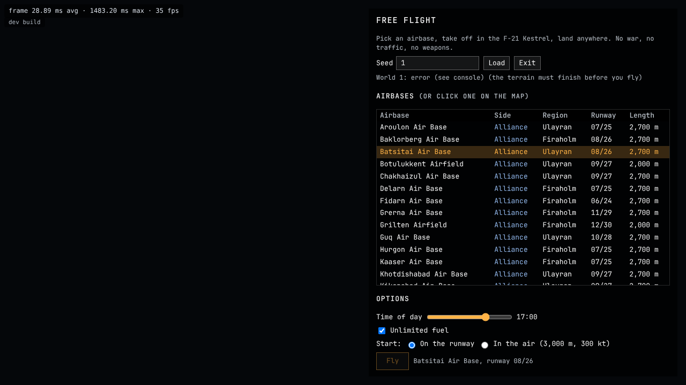
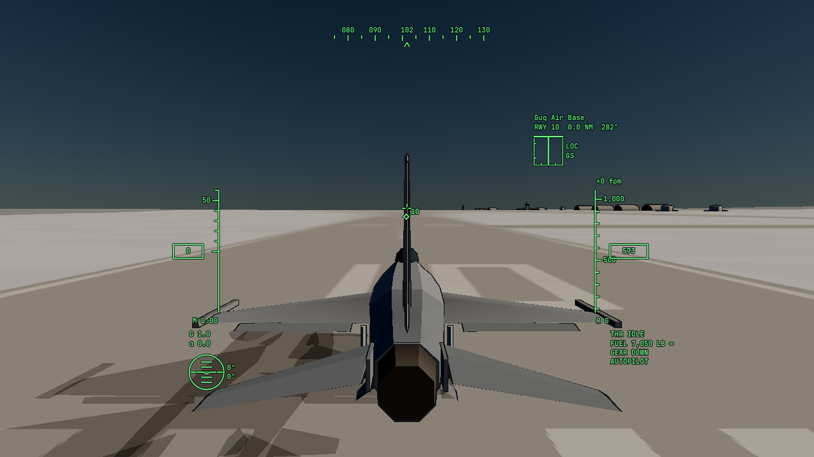
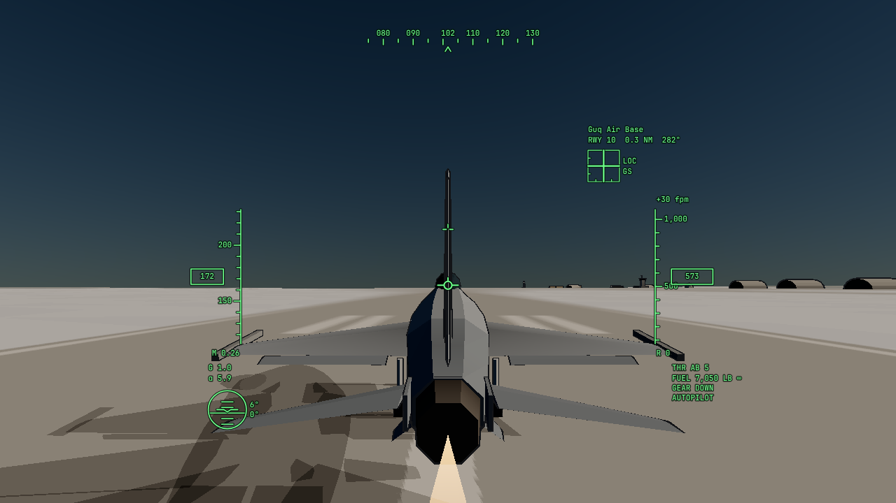
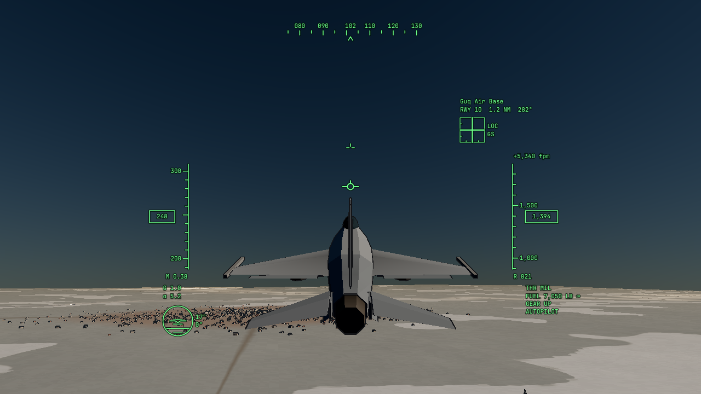
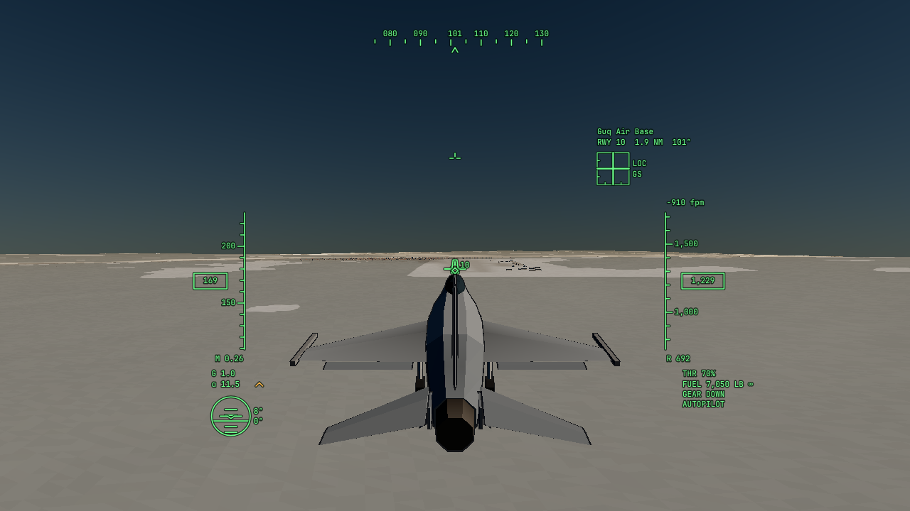
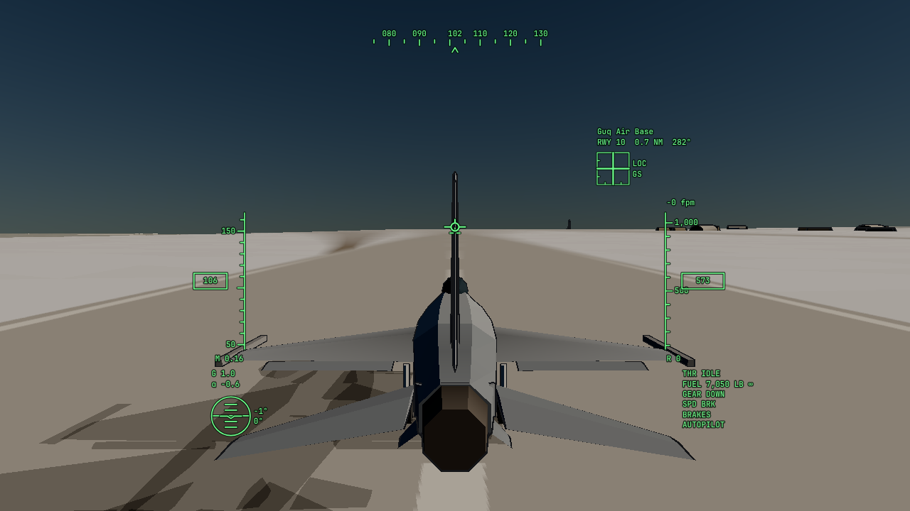

# Free Flight: overnight report

_2026-11-13. Branch `feature/free-flight`. Plan: [docs/plans/free-flight.md](../plans/free-flight.md). Decisions 134 and 135 in [docs/decisions.md](../decisions.md)._

Free Flight is a sandbox: pick a seed and an airbase, spawn on the runway in the F-21 Kestrel (the F-16 analogue), take off, fly anywhere, and land at the same or another airbase. No war, no traffic, no weapons. All eight phases are done. The flight model, the ground model and the outcomes are proven by a headless test that takes off from a generated airbase, flies a 1,000 m circuit and lands in the touchdown zone. One gap matters most: **I could not fly the app end to end in a browser**. In this cloud container, headless Chromium's software WebGPU loses its device during the world's GPU pass, in the normal app as well as in Free Flight. The screenshots therefore come from the project's Dawn renderer, with the real HUD drawn over them in Chromium. Your first desktop session will be the first time anyone flies it interactively.

## What works

- **Entry.** `?mode=freeflight&seed=<seed>` opens the start screen over the strategic map; a button in the debug GUI opens it for the current seed. `&base=<id>` spawns as soon as the terrain is ready. `tod`, `spawn=runway|air`, `fuel=unlimited|limited` and `autopilot` (the scripted pilot flies) also work. No war simulation runs in the mode.
- **Start screen.** Seed field, every airbase with its side, region (its landmass), designators and runway length, Alliance first. Clicking a row, or the map near a base, selects it and centers the map. Options: time of day (17:00 default), unlimited fuel (on), runway or air start (3,000 m, 300 kt along the runway).
- **Runways.** These already existed: heading and length from the coarse pass, 45 m wide, graded flat with a smooth 400 m blend (decision 108), paint and edge lights that come on at dusk (decisions 109, 110). New: touchdown-zone bars. The flight model's ground on the pad is the pad's elevation, the same number the terrain shader uses at every tile level. A test confirms the wheels rest exactly on it.
- **Flight model** (`src/sim/flight/`, headless, deterministic, 120 Hz × 4 substeps, float64 planet coordinates). It has the standard atmosphere, thrust tables (idle, military, afterburner) with spool lags, lift with a stall break, drag with a transonic rise, gear, flaps and speedbrake increments, and ground effect. The control laws follow the F-16: load-factor command blending to pitch-rate command at low speed and on the ground, roll-rate command, sideslip command with turn coordination, α limiter near 25°, +9/−3 g, and a stick prefilter. The ground model has three spring-damper wheels with grip springs (zero drift when braked), differential braking, nosewheel steering that fades with speed, and a parking brake. Gear transit takes 6 s, with a 300 kt warning. Outcomes cover liftoff, touchdown (sink, speed, distance from the threshold, centerline offset, grade), full stop, hard landing and crash. All coefficients live in the Kestrel's JSON spec.
- **Controls.** One remappable binding table. Keyboard stick with return to center; mouse as stick (M); mouse aim through the flight director (N, simplified, see below). Throttle on Shift/Ctrl, = and −, and the wheel, with detents at idle, military and the afterburner gate. Gear G, speedbrake B, brakes Space, parking brake P, help H, debug F3, pause Esc. Free look with the right mouse button or C. Basic gamepad axes.
- **Camera.** A spring-damped chase camera that lags rolls and acceleration, lowers and closes in on the ground, keeps the eye above the terrain, and springs back after free look. In flight it leans toward the velocity rather than the nose, so the runway shows above the aircraft on final. The first renders, with a nose-aligned camera, hid the runway behind the airframe at approach angle of attack.
- **Aircraft.** The Kestrel's spec gains hinge-animated stabilators, flaperons, rudder, split speedbrakes and three gear legs (566 triangles), driven by the control laws and the gear and speedbrake positions. It also gets an afterburner flame, an ink outline and a shadow on the ground.
- **HUD** (Canvas 2D, green with a dark halo, knots and feet). Flight path marker, boresight, destination runway outline and aim point; speed, altitude and heading tapes; Mach, vertical speed, radar altitude below 1,500 ft; compact attitude indicator; G; α with a 13° approach indexer; throttle with afterburner stage; fuel; gear, speedbrake and brake states. A landing aid shows distance, bearing, and localizer and glideslope needles for the 3° path. Messages: airborne, touchdown summary with grade, gear speed limit, stall, pull up, crash reason. F3 opens a debug panel (α, β, CL, CD, thrust, q, n, body forces, frame and physics time).
- **Session.** Pause menu: resume, restart on the runway, air start, change airbase, return to the start screen, options. A summary card appears after a full stop or a crash, and offers to refuel and take off again when you stopped at another base.

### Screenshots

The start screen in headless Chromium, with a base selected (it writes `base=5` into the URL). The map behind it is black and **Fly** stays disabled, because this container's WebGPU device is lost in the world's GPU pass (see above); on a desktop the map draws and **Fly** enables when the terrain is ready.

Rendered by `tools/freeflight.preview.ts` (Dawn on lavapipe, the same `GlobeScene` the app draws) while the scripted pilot flies seed 1's Guq Air Base at 13:00 local. The HUD was drawn over each render by `tools/freeflight.screens.mjs` in Chromium, using the app's own `hud.ts`. Clouds are off; Free Flight has no weather.

|                                                                       |                                                                    |
| --------------------------------------------------------------------- | ------------------------------------------------------------------ |
|  On the runway, parking brake set |  Rotation, about 170 kt           |
|  Climb-out, gear up                        |  Final approach, 200 m, gear down |
|  Rollout, speedbrakes out    |                                                                    |

## Simplified or stubbed, and why

1. **No interactive browser run.** Explained above. The start screen did render in Chromium (it appears before the GPU pass) and lists the airbases.
2. **Rotational dynamics come from the control laws**, not from aerodynamic moment tables. The laws ask for the moment that reaches their commanded rates, within an authority proportional to dynamic pressure. This keeps a medium-fidelity model stable and easy to tune. The cost: no departures or spins, and the airframe's natural stability matters only through damping and weathercock terms.
3. **Mouse aim** flies toward the direction under the cursor in the chase view, not toward a world-locked aim point with the camera following it (War Thunder's scheme, which Proposal 0002 describes). Holding the cursor off center turns continuously. Doing it properly means letting the aim point drive the camera, which is P1 work.
4. **No weather.** The mode runs no sim worker, so the sky is clear and there is no wind.
5. **Runway pavement stays concrete**, not the dark asphalt the task asked for. Decisions 65 and 109 and the style guide's pale concrete set it, and the paint reads on it. It is a one-line change if you prefer asphalt.
6. **Runway headings** follow the prevailing winds, as before, not the flattest axis. Changing them would move every existing world's airfields.
7. **Gamepad**: axes only (stick, twist, a throttle axis on non-standard pads, right trigger brakes); no button bindings or calibration.
8. **The Kestrel stays at the fighter detail level** (566 triangles). The controlled-aircraft level of 1,500–4,000 triangles, navigation lights and a blinking beacon belong to V4.
9. **Commits.** Phases 1, 4, 5 and 6 share one commit, because the mode's controller ties them together and splitting would have left broken intermediate states. Phase 2 had little left to do (touchdown-zone bars), so it went in with the documentation commit.

## Decisions and deviations

- **Decision 134** (the mode and the flight model) and **decision 135** (camera, model, HUD, input, how it was checked) in `docs/decisions.md`.
- **Deviation from Proposal 0002 and the design:** the player takes off and lands, and the aircraft animates its gear. `docs/design.md` (_Non-goals_, _Flying_, _Later_) and `docs/visual-style.md` (_The Controlled Aircraft_, _HUD and Displays_) name the exception. Takeoff and landing stay with the AI in the campaign.
- **Direct control is the default** in Free Flight; mouse aim is a toggle.
- **The player's flight model runs on the main thread** in this mode. P1 still decides for the campaign.
- **A curvature-compensated 1-g reference.** On a 1,000 km planet, level flight needs about 0.25% less than 1 g at 300 kt. A plain 1-g hold climbs at 1.5 m/s, so the control law subtracts v²/r. This acts as the mode's pitch trim.
- **Ground effect** was added after the first circuits: without it, the flare could not arrest a 4.4 m/s sink within the 14° tail clearance.
- **HUD color** `#6CFF8A` with halo `rgba(0, 18, 6, 0.75)`: a starting value, recorded in the style guide, for P2 to tune.
- **Branch and pull request** instead of CLAUDE.md's "commit to main only", as you asked for this task.

## Test results

`npm run check` passes: type check, lint, and 506 tests in 82 files. The GPU tests ran too, on lavapipe.

| Target                                               | Result                                                                                             |
| ---------------------------------------------------- | -------------------------------------------------------------------------------------------------- |
| Takeoff roll in afterburner, 500–1,000 m             | 530 m (liftoff at 171 KCAS)                                                                        |
| Rotation speed, 140–160 kt                           | nosewheel lifts at 147 KCAS with full aft stick                                                    |
| Stall in landing configuration, 120–140 kt           | 125 KCAS (10.8 t)                                                                                  |
| Sea-level maximum speed in afterburner, Mach 1.1–1.2 | Mach 1.12 at 300 m                                                                                 |
| Stable level flight at 300 kt with trim              | 60 s hands off within 0.2 m and 0.6 kt                                                             |
| Rest on the runway, no drift over 60 s               | under 1 cm (5·10⁻⁹ m measured), velocity under 1 mm/s                                              |
| Determinism                                          | identical states bit for bit for identical input sequences                                         |
| Control-law limits                                   | +9 g and −3 g held; α peaks under 26.5°; roll rate 200–245°/s; sideslip under 2° in a rolling turn |

`tools/flight.preview.ts` prints these figures.

**Headless flight test** (`tests/freeFlight.test.ts`). Seed 1, Araikul Air Base (a 2,700 m runway at 19 m elevation), using the app's ground query, grading and runway records. The scripted pilot lifts off at 17 s and climbs to 1,003 m above the field, with a top speed of 308 KCAS. It flies upwind, crosswind, downwind and base, intercepts a 3° final at about 159 KIAS, and touches down **491 m past the threshold of runway 10 at 0.69 m/s sink, 2 cm left of the centerline** (grade: smooth). It stops on the same runway, 520 s after brake release. A second test checks that the wheels rest exactly on the graded pad.

## Known issues, by severity

1. **Not flown interactively in a browser.** Input feel, frame rate with the HUD, camera behavior under a real hand on the stick, and the menus' flow are unverified end to end. Everything below the UI is tested; the UI code ran only in the type checker, in the start-screen check and in the HUD composites.
2. **Mouse aim is the simplified scheme** (above). In a hard turn the cursor's direction moves with the lagging camera, so it may feel loose.
3. **With unlimited fuel the Kestrel always weighs 13.3 t**, so it approaches near 164 kt at 13° α, fast for an F-16. A lighter landing state needs limited fuel or an initial-fuel option.
4. **Taxiing at speed can tip the aircraft.** The narrow track and high CG let a hard nosewheel turn above about 10 m/s lift a main wheel; the steering fades with speed to limit this. It is realistic, but unforgiving with a keyboard.
5. **The shadow** is a planar projection onto a flat plane under the aircraft. It ignores slopes, darkens twice where the wing and body shadows overlap (visible on the runway shot; a stencil pass would fix it), and it is hidden above 400 m.
6. **The touchdown summary** counts every first wheel contact after 0.5 s airborne. A bounce gives a second touchdown message.
7. **Retracted main wheels show** as dark shapes under the wing roots (visible in the climb shot): the model has no wheel wells or doors.

## Try it on your desktop

1. `git fetch && git checkout feature/free-flight && npm install`
2. `npm run dev`
3. Open `http://localhost:5173/?mode=freeflight&seed=1` in a WebGPU browser (Chrome or Edge).
4. Wait for the status line to read _done_. The first generation takes a while; later loads come from the cache.
5. Pick an Alliance base, for example **Guq Air Base** (id 4 at the default resolution; the one in the screenshots), or click a base on the map. Keep _On the runway_ and press **Fly**.
6. Press **H** for the bindings. Then: **P** releases the parking brake. Hold **Shift** to the military detent, release, and press **Shift** again for afterburner. Keep straight with **Q/E**. At about 150 kt, hold **S** to rotate to 10°. Press **G** to raise the gear.
7. Fly a circuit, or another base's runway: the landing aid picks the nearest runway within 80 km. **G** lowers the gear below 300 kt. Fly the HUD's α indexer to the circle (13°) and keep both needles centered. Close the throttle at the threshold, hold **Space** after the nosewheel is down, and stop on the runway for the summary.
8. Shortcuts: `&base=<id>` (hover a row on the start screen for its id) spawns at once, `&spawn=air` starts in the air, and `&autopilot` lets the test pilot fly the circuit for you.

## The three most valuable next steps

1. **Fly it and tune the feel.** Rotation authority, roll and pitch response, the flare and ground handling are tuned only against numbers so far. An hour of desktop flying will show what the tests cannot, and the tables in `alliance-fighter.json` and the gains in `controlLaws.ts` are where to turn the knobs.
2. **Proper mouse aim and the controlled-aircraft model** (P1, V4): a world-locked aim point that the camera follows, and the 1,500–4,000-triangle Kestrel with lights. These are the two things a player will notice first after the basics.
3. **Weather and fuel in Free Flight:** run the weather model without the war (clouds, wind, crosswind landings) and add an initial-fuel option. That makes landings at other bases a real exercise and exercises the flight model's wind handling before P1 needs it.
