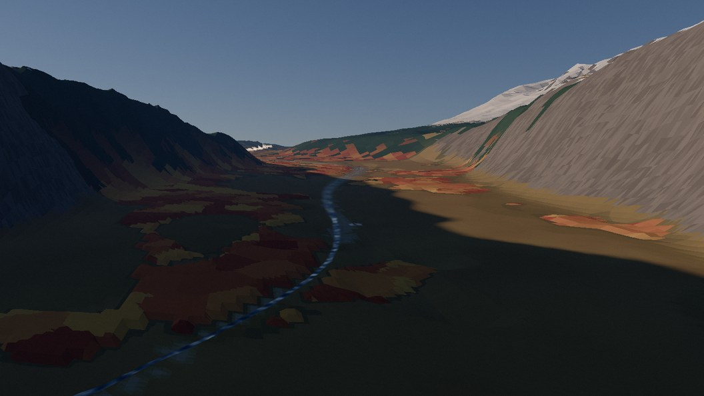
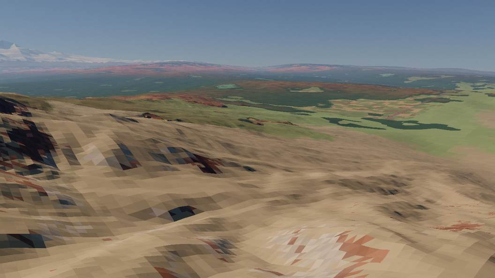
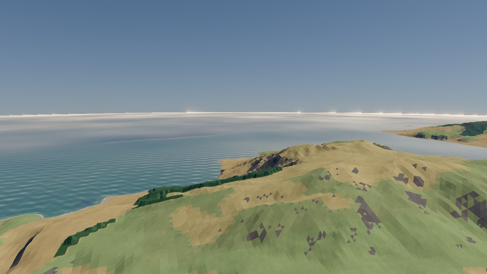

# Terrain Art Baseline (Proposal 0010, Phase 0)

_Measured 2026-11-21 on `main` at 7deeac1, before any of Proposal 0010's work (decision 296)._

## Setup

- Seed 1983 (the default world), tectonic 256², global 1024², relief exaggeration not yet introduced (equivalent to 1.0).
- `tools/render.preview.ts` with `ART_VIEWS=1 WEATHER=clear PERF=3 W=1408 H=792 DETAIL=1`: the proposal's three standard views, timed over three frames each.
- The machine is a cloud container without a GPU: Dawn on lavapipe, Mesa's software Vulkan driver. **Absolute frame times are meaningless here** (a frame takes 0.4–0.7 s); draw calls, triangles and the CPU's share per frame are what this baseline is for, and later phases compare frame times only as ratios on the same machine.

## Standard Views

The proposal names an alpine valley at 500 m, a canyon at 300 m and a coast at 1 km. The preview places them at `tools/landscapeSpots.ts`'s glacial, canyon and cliffs spots, with the eye that high above the ground. Seed 1983 has no warm, low coast (`beach` target), so the coast view looks over a cliff coast instead.

| View | Spot (lat, lon) | Eye |
|---|---|---|
| `art-valley` | 42.535, −148.727 | 500 m |
| `art-canyon` | 19.048, −80.097 | 300 m |
| `art-coast` | −15.680, 164.438 | 1,000 m |

## Measurements

| View | Frame (software) | CPU per frame (median) | Terrain | Trees | Ground cover | Other |
|---|---|---|---|---|---|---|
| `art-valley` | 701 ms | 8.9 ms | 55 draws, 0.48 M tris | 17 draws, 0.02 M tris | — | cities 2 draws |
| `art-canyon` | 435 ms | 6.3 ms | 47 draws, 0.41 M tris | — | 4 draws, 0.021 M tris | cities 2 draws |
| `art-coast` | 367 ms | 4.6 ms | 33 draws, 0.29 M tris | — | 4 draws, 0.021 M tris | — |

All three views sit well inside Part I's budgets (under 500 draws, under 2 M triangles). The proposal's own budgets are relative to these: rock dressing at most 20% of the scene triangle budget (0.4 M) and 30 draws; atmospheric effects at most 1.5 ms; a total frame time increase of at most 3 ms on the target laptop. On this machine the last two are checked as ratios of the software frame time (see the metrics report).

## Views

## Health

`npm test` on this machine before any change: 1,394 of 1,395 tests pass. The failure is `tests/gpu/mapSoak.test.ts` (*keeps the relief tiles within their caches while panning at the floor*), a soak test of the strategic map's caches whose geometry count peaks at 274 against a limit of 234 on the software GPU; it is not related to this work and was failing before it.
