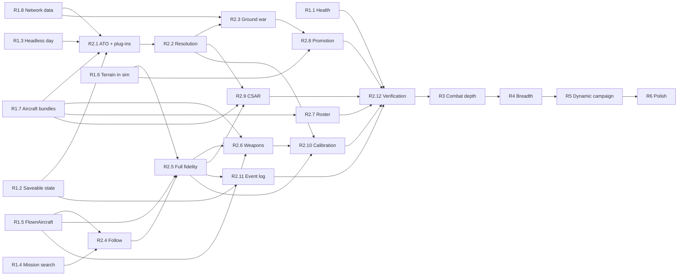

# Bearing Roadmap

_Adopted 2026-11-18 with Proposal 0008 (`docs/proposals/0008-game-loop-and-campaign.md`, decision 228). This document is the source of truth for what to build next. It supersedes the milestone sections of `docs/design.md` and the roadmap sections of proposals 0001–0007. `docs/status/audit-2026-11-18.md` records the state each phase starts from; `TODO.md` breaks the current phases into tasks._

## How to Read This

- **Phases** R0–R6 come from Proposal 0008. Each phase has **milestones** (R1.1, R1.2, …) with tasks, dependencies, an exit criterion and a size.
- **Sizes:** _small_ fits one working session; _medium_ takes two to four; _large_ takes five or more and should be split into tasks of a few hours in `TODO.md` before it starts.
- **Visual milestones** still close only after the acceptance checks of `docs/visual-style.md` for the views they touch (`CLAUDE.md`, _Working rules_). Here they are R1.1, R2.4, R2.6, R2.7, R2.8, R2.12, R3.2–R3.6, all of R4 except R4.6's aggregates, R5.5 and all of R6.
- **Earlier tracks.** The old milestone names (F, S, C, V, I, P, H, N, G, W) survive in decisions and plans. _Where the Old Milestones Went_ maps each to its place here, and `docs/status/todo-2026-11-18.md` keeps the old `TODO.md` with every open item as it stood.

## Phase Overview

| Phase                   | Goal                                                                         | Milestones | State             |
| ----------------------- | ---------------------------------------------------------------------------- | ---------- | ----------------- |
| R0. Audit and reconcile | Know what exists; documents match the code                                   | —          | done (this audit) |
| R1. Consolidation       | What the demo needs from earlier tracks, and nothing more                    | R1.1–R1.8  | done              |
| R2. One day of war      | The thin, complete loop: the tech demo                                       | R2.1–R2.12 | R2.1–R2.3 done, R2.4 built |
| R3. Combat depth        | Sensors, weapons, air combat, air defense, ground entities                   | R3.1–R3.6  |                   |
| R4. Breadth             | Roster, mission catalog, helicopters, transport, crews, naval war            | R4.1–R4.7  |                   |
| R5. Dynamic campaign    | Logistics, morale, weeks of war, saves, consequences                         | R5.1–R5.6  |                   |
| R6. Polish              | Onboarding, briefings, audio, performance, accessibility, the visual backlog | R6.1–R6.8  |                   |

## R0. Audit and Reconcile (done)

The audit of 2026-11-18 built the status matrix, measured test and build health, reconciled `design.md`, `visual-style.md`, `CLAUDE.md`, `README.md`, the proposals and the plans with the code, rewrote `TODO.md`, and listed the decisions for the owner (`docs/status/audit-2026-11-18.md`). Exit: this roadmap and the owner's answers to the audit's decisions.

## R1. Consolidation

R1 contains exactly what the audit found missing or partial that R2 needs. Each milestone names the R2 milestones that wait on it.

### R1.1 Health and Baselines — medium

_Needed by every R2 milestone: R2's exit criteria include determinism, three seeds and frame budgets._

- Fix the cube-face seam in the tile kernel, or re-baseline the test with a decision.
- Close or reproduce the front generator's determinism flake: run the campaign determinism tests 50 times in CI-like conditions; if it recurs, quantize the band cut (decision 86's fallback).
- Pin the demo seeds: 4, 10 and 7 (the highest front fits on generator 34) with a seeds regression test that fails when one loses its continental front.
- Profile the strategic map (10–15 fps) and the session-long frame-rate decay; fix the leak.
- A GPU timing tool (timestamp queries) and one run of `tools/browser.smoke.mjs` with `MODE=gpu` on the owner's machine, to give R2 a real baseline.
- Rerun the whole-world alignment on a desktop and record the times.

**Exit:** green CPU and GPU suites, three pinned seeds, a strategic map at its frame budget on the owner's machine, and a recorded GPU baseline for the standard views.

**State (2026-11-19):** done. The seam (decision 233), the front generator's flake (decision 234), the demo seeds pinned, the GPU flake measured, `networkLink`'s timeout, the GPU timing tool and the owner's `MODE=gpu` baseline (decision 242), green suites on the owner's GPU (decision 244), the map from 10–15 fps to 50 fps and more on the owner's machine with no decay (decisions 245, 246). The map's last few milliseconds to a steady 60 fps (its main pass's GPU time) and the desktop alignment rerun are TODO items for R6.4; neither gates R2.

### R1.2 Campaign State That Can Be Saved — medium

_Needed by R2.11 (event log and replay) and everything that changes sim state._

- `save()` and `load()` for every sim process: the event queue, `AirOps`, the tasker's maps, the weather systems and the clock.
- Export the RNG state, or make every draw a fork keyed by game time (the tasker and weather already fork per hour).
- A snapshot round-trip test: run, snapshot, restore, run on, and compare hashes with an uninterrupted run.
- The event log's skeleton: player inputs to the campaign and campaign-level decisions as typed, timestamped events.
- Replace `SimHost.seek`'s rebuild with snapshot plus log, which fixes the dropped alarms.

**Exit:** a snapshot taken at any time restores to the same state hash at 1× and 64×.

**State (2026-11-19):** done (decision 235).

### R1.3 A Headless Day of War — small

_Needed by R2.1–R2.3 and R2.12._

- A tool that runs the campaign on a generated world (the pinned seeds) for 24 game hours as fast as it can, and reports errors, step cost per game hour and the state hash.
- One integration test on a small generated world in place of the synthetic air-war world.

**Exit:** the tool runs today's interim tasker for 24 h on the three seeds without errors and reports the worker's cost at 64×.

**State (2026-11-19):** done (decision 236).

### R1.4 Mission Search Shell and Side Selection — medium

_Needed by R2.4 (follow) and R2.5 (take over)._

- Side selection at campaign start, with the generated briefing.
- The mission search panel over the strategic view: ongoing and upcoming missions of the viewing side, filters (type, aircraft, theater, phase, time until action), focus on the map with the route drawn.
- Jump-in windows as data on each mission's phases.
- Subscriptions: a saved query plus a phase, flagged phase events, auto-slowdown to 1× and an offer.

**Exit:** the owner finds the next CAS mission over the front in under ten seconds, and a subscription drops 64× to 1× when its mission reaches the chosen phase.

**State (2026-11-19):** done (decisions 241, 248). The subscription criterion holds in a test; the owner found the next CAS mission over the front (Pontiac 35, seed 4) once the campaign opened on a demo seed.

### R1.5 The Flown Aircraft Leaves Free Flight — large

_Needed by R2.4–R2.7._

- Extract a `FlownAircraft` from `freeflight/freeFlight.ts`: airframe, control laws, director, input source (player or AI), avionics state, sensors and the HUD frame, usable by Free Flight and the campaign alike.
- Move `AvionicsState` from the UI's `DisplaySystem` into per-aircraft sim state; build the aircraft snapshot outside `freeflight/`.
- One clock: Free Flight's `clock.ts` and the campaign clock share the game-time type and stepping rules.
- Free Flight keeps working unchanged: the lockstep test passes bit for bit.

**Exit:** Free Flight runs on `FlownAircraft`; a test creates one for a campaign flight from a position, velocity and fuel and flies it with the scripted pilot.

**State (2026-11-19):** done (decision 243).

### R1.6 Terrain for the Execution Layer — medium

_Needed by R2.2 (low-level resolution), R2.5 (handover over terrain), R2.8 (vehicles)._

- Move the assembly of `TerrainEdits` from `render/sim/infra/airfieldGrading.ts` into `worldgen/edits/`, so the worker can build the one height function (rule 13).
- A deterministic height service from the global grid plus edits, available in the worker; AI sensing and line of sight read it (owner decision 9).
- Analytic low-level routes keep a terrain floor instead of 100 m above sea level.
- Full-fidelity flight and the simulation view use the sited runway; the campaign keeps the coarse point (owner decision 8).

**Exit:** no analytic low-level route on the pinned seeds passes below the terrain; a flight handed to full fidelity at any point of its route is above the ground.

**State (2026-11-19):** done (decision 240); the route criterion holds against the coarse ground. The handover criterion moves to R2.5, where a flight is first handed over above the drawn ground (TODO R2.5).

### R1.7 Aircraft Bundles and Roster Data — medium

_Needed by R2.1, R2.6, R2.7, R2.9._

- Every aircraft type becomes one JSON bundle (decision 232): the model spec gains the avionics profile (from `typeProfiles.ts`), the air-war entry (role tags, performance, crew roles, faction, name, skin, from `sim/air/aircraft.ts`), pylons and loadouts, the camera rig (from `FAST_JET_RIG` and `helicopterRig`) and a calibration block. Types without geometry yet get a spec without geometry. One loader serves the sim worker and the renderer, and a test lists what each bundle lacks.
- A utility helicopter role with a Black Hawk and an Mi-8 analogue in the air war; rename the UH-68 "Buzzard" (owner decisions 3, 4), recorded as a change to every world's cast.
- Pilots per squadron in the order of battle (data only; R2.2 uses them).

**Exit:** all 31 air-war types load from their bundles with the same performance and avionics as before (the air war's determinism hash unchanged); the bundle test lists the demo roster's missing parts as R2.7's work.

**State (2026-11-19):** done (decisions 238, 239).

### R1.8 Network Data for the Sim — medium

_Needed by R2.1 (interdiction), R2.2 (strike effects), R2.3 (supply and movement)._

- The road and rail networks as a node and edge graph in the campaign input: junctions as nodes, polylines as edges, bridges as edges a strike can cut.
- A damage state for targets and bridges in the sim.
- Bridge aim points: each network bridge drawn at its matched crossing, or at the nearest point of its aligned road (owner decision 7); the aim point lives on the main thread only.

**Exit:** a test cuts a bridge and the detour the graph finds equals the bridge's recorded detour within a tolerance.

**State (2026-11-19):** done (decision 237).

## R2. One Day of War (Tech Demo)

R2 builds the thin, complete loop of Proposal 0008: plan, execute, resolve, consequence, replan, with the player joining any mission. It uses one continental-front theater for 24 game hours.

### R2.1 Mission Plug-ins and the Air Tasking Order — large

_Depends on R1.2, R1.3, R1.7, R1.8._

- The mission plug-in interface with its eight parts (see _Adding Mission and Aircraft Types_), and a test that each registered type has all of them.
- The ATO: needs from the front (segments under pressure, supply behind it), from bases and from high-value assets; priority scores with stable tie-breaking; packages from squadrons in range with escorts; Pact waves and Alliance spreading; one order per game day and revisions every two to four hours.
- Weather and daylight minimums; winds aloft in ground speed.
- The four demo types as plug-ins: CAP, interdiction (fixed targets: bridges, depots, rail yards, road segments; owner decision 10), CAS (fixed-wing) and airlift.
- The interim tasker retires.

**Exit:** both sides generate and revise orders with all four types on the three seeds; the orders are identical at 1× and 64× and independent of the viewing side.

**State (2026-11-19):** done (decision 249). The demo types' resolvers (R2.2) and AI behavior (R2.5) are pending markers in their plug-ins; the interim tasker's other types fly as provisional plug-ins until R4.2.

### R2.2 Resolution and Consequences — large

_Depends on R2.1._

- Aggregate resolvers for the four types: air-to-air engagements between packages and CAP, point defenses at targets (an abstract air defense value per site until R3.5), strike damage to targets and bridges, airlift deliveries into base stocks.
- Losses lower squadron strength; pilots eject and become survivors (R2.9); missions abort and return.
- Outcomes feed the next ATO revision.

**Exit:** over 24 h on the three seeds, both sides lose aircraft, targets and bridges are damaged, airlift raises a base's stocks, and the next revision reacts to each.

**State (2026-11-19):** done (decision 250). The resolvers' constants and each type's combat values are priors until R2.10's calibration fits them.

### R2.3 The Ground War in Aggregate — large

_Depends on R1.8, R2.2._

- Order of battle: divisions, brigades or regiments, battalions with per-unit seeds (ready for promotion).
- Deployment along the start line; Lanchester attrition each game minute with terrain, posture, supply and air support.
- Supply over the road graph, cut by bridge damage; front segments move by local force balance, slowed by barriers; offensives along the invasion corridors by the cast posture.
- The moving front and battalion symbols on the strategic map.
- A comparison tool: the same seed with one side's air support suppressed.

**Exit:** the front moves measurably in 24 h, and the suppressed run ends with a different front.

**State (2026-11-19):** done (decision 251). The map shows brigades and regiments rather than battalions; the constants are priors for R5.6 to tune.

### R2.4 Follow — medium

_Depends on R1.4, R1.5, R1.7._

- Aircraft of campaign flights in the simulation view, instanced, with a level of detail for packages.
- _Follow_ from mission search and from a subscription offer: a cut with a chase-camera settle (owner decision 12) behind one aircraft of the mission; return to the map above the flight.
- The read-only HUD and the followed aircraft's own displays (spectator displays).
- Per-type camera rigs from the bundles.

**Exit:** the owner follows a mission of each demo type from the map and returns, with acceptance checks 7 and 10.

**State (2026-11-20):** done (decisions 252–255): the owner followed a mission of each demo type on the GPU with checks 7 and 10 passing (`ONLY=follow`, seed 4), and checked the fixes of the two reviews.

### R2.5 Full Fidelity and Handover — large

_Depends on R1.5, R1.6, R2.4._

- Promotion: a followed flight's aircraft become `FlownAircraft` from their analytic state (position, attitude, speed, fuel, stores, damage); demotion folds them back. Both preserve losses and expended weapons.
- An AI pilot on the flight director: route following, formation, orbit, attack run, egress.
- _Take over_ inside the jump-in window (climb-out to approach; owner decision 13); _hand back_ gives the director the AI's orders.
- The flight cap: up to 8× in cruise while the player flies, cancelled on any threat.
- A session's consequences return to the worker as logged campaign events (owner decision 1).

**Exit:** take over and hand back at every phase of a CAP mission, with the mission completing; losses and stores survive both directions.

**State (2026-11-20):** done in code (decisions 256, 257, 272–277, 280–284): promotion, demotion and the rejoin route, the AI pilot, the worker's hold and rebuild, the follow at full fidelity in the campaign's wind, take over and hand back (T), the flight cap, the session's consequences, the plug-ins' behavior parts, the abort's turn and the F-21's climb; the exit test passes headless (`tests/handoverExit.test.ts`), and the owner took over and handed back an F-21 on the GPU (gear fixed in decision 277). Open for the owner: a CAP take-over waits on the F-25's and F-28's flight data (R2.7), since the F-21 flies only interdiction on seed 4.

### R2.6 Weapons, Damage and Interface Defaults — large

_Depends on R1.5, R1.7, R2.5._

- Pylons and loadouts in the bundles; stores on pylons that disappear on release; the stores format; master arm.
- Guns with a lead-computing pipper, one IR missile per side with a seeker circle, unguided bombs with CCIP fall lines, rockets (owner decision 6).
- Hit and kill resolution, minimal damage states, ejection from full fidelity.
- The sensors read campaign contacts: aggregate flights become radar targets, sites with radars become emitters.
- Interface defaults per mission type and phase: master mode, formats, HUD cues and declutter; route and waypoints on the moving map and HUD steering.
- The player's own flight always in view: its other aircraft marked on the HUD and on the moving map and radar by the intraflight datalink, so a wingman a mile abeam is found at a glance (decision 258).
- Acceptance check 8 with the pipper.

**Exit:** the player shoots down an AI aircraft on CAP and hits a bridge with bombs on interdiction, and both reach the campaign's state.

### R2.7 The Demo Roster — large

_Depends on R1.7; the flight data waits for R1.5's per-type laws._

- Flyable (owner decision 5): Kestrel (exists), Vo-31 (MiG-29) and Vo-35 (Su-25) with flight data and per-type control laws; A-15 (A-10) and C-150 (C-130) with models and flight data if time allows, flown by the AI otherwise.
- AI-only models for the types the demo's orders fly: F-25 (F-15), E-5 (E-3), KC-40 (KC-135), Vo-37 (Su-24), Ra-44 (An-12), Ra-60 (A-50), Ve-28 (Mi-24) and the utility helicopters.
- The Pact skin seen in a flown Vo-31 and Vo-35; displays checks 12–13 for an attack aircraft.

**Exit:** every type on the demo's orders has a model, and every flyable type passes the silhouette check and checks 12–13.

### R2.8 Minimal Entity Promotion — medium

_Depends on R1.6, R2.3._

- Near the player, a battalion spawns a few representative vehicles (tanks, infantry fighting vehicles, trucks, a short-range air defense vehicle) on the ground or aligned roads, from its seed and strength.
- Vehicle models from the kit; vehicles are targets; their losses fold back into the battalion's strength.

**Exit:** CAS destroys promoted vehicles and the battalion's strength drops by the same count.

### R2.9 Survivors and CSAR — large

_Depends on R1.7, R2.2, R2.5._

- Survivors with position, injury state, survival timer and a capture risk that grows near enemy forces.
- The CSAR mission plug-in: the owning side always tasks one (rescue helicopter, escort, cover); an aggregate resolver for when no one watches.
- A rotary flight director and an AI helicopter pilot (route, approach, landing at a point) with the Assisted laws (owner decision 3); a surface-layer wind for hovering.
- Outcomes: rescued pilots return to their squadron's pool, which limits sorties.

**Exit:** every ejection in a 24 h run produces a survivor and a CSAR mission; a followed CSAR helicopter lands at the survivor at full fidelity.

### R2.10 Calibration — medium

_Depends on R2.2, R2.5, R2.6._

- A headless runner flies many full-fidelity engagements per demo matchup (two Vo-31 against two Kestrels at a set range and altitude; CAS against a SHORAD vehicle) and fits the aggregate tables.
- The tables live in the repository, a script regenerates them, and a test keeps aggregate and full-fidelity outcome rates within tolerance.

**Exit:** the tolerance test passes for every demo matchup.

### R2.11 Event Log and Replay — medium

_Depends on R1.2, R2.5._

- Every player input to the campaign, every campaign-level decision and every fidelity session's consequences go into the log.
- Replay from a snapshot; export and import of a log as a file.

**Exit:** replaying a session's log from its starting snapshot reproduces the same final state hash.

### R2.12 Demo Verification — medium

_Depends on all of R2._

- Three seeds × 24 h at 64× unattended; the suppressed-air comparison; take over and hand back in each flyable aircraft.
- Frame budgets on a real GPU during a full-fidelity mission with the war running.
- Acceptance checks 7–10 and 12–14 for the demo types; Part II checks for the moving front and unit symbols.
- A report in `docs/reports/` and the owner's checkpoint.

**Exit:** every tech demo exit criterion of Proposal 0008 holds.

## R3. Combat Depth

- **R3.1 Intelligence — large.** The per-side picture with decay, satellites on Cold War orbits with imaging conditions and delivery delays, the radar air picture with ground-controlled interception, reconnaissance refreshing contacts; interdiction of moving targets. _Depends on R2.2._
- **R3.2 Sensors and displays in full — large.** The AI reads the same filtered picture (rule 12); radar designation by keys, elevation bars, clutter by terrain; moving-target and terrain-following modes; datalink from a real AEW or ground controller; the targeting pod format; alerts that claim a slot; engines and fuel with damage; the Su-27 analogue's HUD radar; checks 12–14 for more types. _Depends on R2.6._
- **R3.3 Weapons in full — large.** Radar missiles: semi-active (Sparrow analogues, Fox 1) for most types, the navy fighter's long-range missile (the F-28's Phoenix analogue) for bomber raids, and active-radar missiles (Fox 3) as a campaign setting for the late era (owner, decision 258); anti-radiation missiles, CCRP, laser-guided bombs with the pod, countermeasures with programs and the threat warning's launch state, target and weapon cameras, damage effects (smoke, fire, missing parts). _Depends on R3.2._
- **R3.4 Air combat — medium.** BVR timelines for the AI and the player's flight (commit, sort, shot, crank, notch, abort and minimum abort ranges by missile and threat; owner, decision 258) and basic fighter maneuvers in the merge; combat spread's tactical turns (cross, in-place) in place of holding the slot; AI maneuvering in air combat, departures and spins in the flight model, check 9, and a second look at a world-locked mouse aim point (owner decision 14). _Depends on R2.5._
- **R3.5 Air defense networks and scrambles — large.** SAM and AAA sites and belts from the cast, air defense rings on the map, quick-reaction alert and the scramble mission. _Depends on R3.1._
- **R3.7 Routes with steerpoints — large** (owner, decision 286). Routes become steerpoints planned against the threat: low-level legs that follow valleys and canyons under the radar horizon, ingress through holes in the air defense network (R3.5) and the enemy's picture (R3.1), pop-up points, initial points and egress turns, instead of great-circle legs. Shaping a route over terrain is the execution layer's (rule 9 holds: the planner reads the graph and the air defense picture, and the route is fitted to the eroded world by the sim, as the alignment tier fits roads). The steerpoints are what the moving map, the HUD's steering and the AI pilot follow. Enables the owner's two set pieces in R4.2: the canyon run to ambush an AWACS, and the deep low-level strike from a road base. _Depends on R3.1, R3.5, R3.6._
- **R3.6 Ground entities and terrain in the sim — large.** Entity behavior for promoted units (movement on aligned roads, firing, MANPADS teams), line of sight through the canopy height field, tree strikes, props and wonder shapes in the one height function, corridor-aware refinement (spike N6.0), tracks near the camera. _Depends on R2.8, R1.6._

## R4. Breadth

- **R4.1 Roster — large.** Every remaining type through the bundle checklist: the F-15 and Black Hawk analogues become flyable; F-111, A-6, F-14, F-117, Apache, Lynx, Cobra, CH-47 analogues; the Su-24, Mi-24 and Mi-8 analogues become flyable; Su-27, Tu-22M, Tu-95, MiG-23, Mi-26 analogues. Includes the controlled-aircraft detail level with navigation lights. _Depends on R2.7._
- **R4.2 Mission catalog — large.** Fighter sweep, escort, scramble (with R3.5), low-level penetration strike, airfield attack with runway-denial weapons (Durandal analogues: cratered runways close a base for hours; shelters, aircraft on the ground and fuel; decision 254), carrier alpha strikes (a whole air wing in one package), stealth strike, SEAD, attack helicopter CAS, helicopter assault and troop insertion, anti-shipping, maritime patrol, strategic bombing, reconnaissance, AWACS and tanker support, combat airdrop, sling-load resupply, medical evacuation, and full CSAR with escorts and the player flying any part. Two set pieces the owner asked for (decision 286): the **AWACS ambush**, a fighter flight that runs low through a canyon under the enemy's radar, climbs hard and attacks a high-value AEW orbit from below and behind (after the F-15 campaign mission in DCS); and the **deep strike from a road**, a light attack aircraft dispersed to a road base that takes off from the road, flies fast and very low deep into enemy territory and bombs a high-value target (after the AJ-37 Viggen's doctrine). _Depends on R2.1, R3.7 for the set pieces._
- **R4.3 Helicopter track — large.** Plan H's remainder: calibration figures, helipads and landing zones in Free Flight, mouse aim and direct control with sticks, the Standard and Expert presets, the remaining types (teetering, hingeless, tandem, stub wings), ground handling on slopes with dynamic rollover, rooftops and ship decks, hazards and damage (vortex ring state, mast bumping, blade stall, autorotation, tail rotor loss), weapons and gunner mode, AI nap-of-the-earth and battle positions, player-flown helicopter missions with jump-in over their ground phases. _Depends on R2.9, R3.3._
- **R4.4 Transport operations — medium.** The airdrop format and combat airdrop, sling loads with the hook camera, hoist and fast-rope, troop insertion. _Depends on R4.3._
- **R4.5 Crews and radio — large.** Plan P5: crewmates per seat, format ownership, the crew command menu, the six roles, callouts by priority, crew station mode, crew figures. The radio (owner, decision 258): check-ins with the package's strike lead and with AWACS and ground controllers (picture calls, bogey dope, the Pact's ground-controlled interception), air traffic control near airfields (departure, approach), brevity in the comms format and the messages display; controllers' callsigns invented per side, as the setting's names are. _Depends on R3.2._
- **R4.6 Naval war — large.** Convoys, carrier groups tasked between theaters, surface action groups and abstract submarines on sea lanes with aggregate resolvers; amphibious groups, and amphibious and airborne seizure of an island airfield or port, after which a squadron stages forward onto it (the Iceland operation of *Red Storm Rising*, decision 254); Backfire (Ra-84) raids on carrier groups with heavy anti-ship missiles, the outer air battle against them (the carrier's CAP and the F-28's long-range missiles before launch) and the vampire calls and point defense when the missiles are inbound (owner, decision 258); convoy and naval icons on the map; ship decks as moving ground. _Depends on R2.2._
- **R4.8 Road bases — medium** (owner, decision 286). Highway strips sited on long straight stretches of aligned roads near a side's airbases, with dispersal sites; squadrons disperse to them when their base is attacked or cratered (decision 254) or by doctrine (the Alliance's Nordic-style air arms); takeoff and landing on a road at full fidelity and in Free Flight; the strips on the map. _Depends on R4.2._
- **R4.9 Air refueling — medium** (owner, decision 286). Tankers as real support: the Alliance plans tanker tracks into its packages (strike packages, CAP stations far forward, ferry flights), which extend their radius and station time in the aggregate; the Pact's few tankers serve its bombers. At full fidelity the player joins the tanker's boom or drogue with director cues, and the AI refuels by the same law. _Depends on R4.2, R2.6's drop tanks and fuel system._
- **R4.7 Power lines — small.** Pylons on high ground and wire strikes for helicopters, on the corridor framework. _Depends on R4.3._

## R5. Dynamic Campaign

- **R5.1 Logistics — large.** Fuel, munitions, spares, replacement aircraft and pilots over road, rail and sea to depots, bases and the front; base stocks gate sorties; bridges as network nodes with detours. _Depends on R2.3, R4.6._
- **R5.2 Morale and reputation — medium.** Unit, squadron and theater morale on sortie rates, AI skill and ground combat; the named pilot, reputation, and the enemy's reaction (owner decision 11). _Depends on R2.2._
- **R5.3 Weeks of war — medium.** Two to four weeks, end conditions (breakthrough, successful defense, ceasefire from exhaustion), the campaign summary. _Depends on R5.1, R5.2._
- **R5.4 Save and load — medium.** Campaigns in IndexedDB with file export and import, on R1.2's snapshots and R2.11's log. _Depends on R2.11._
- **R5.5 Consequence visibility — medium.** The chain of consequences on the map after a mission (bridge down, supply cut, battalion withdrawing); destroyed structures in the simulation view. _Depends on R5.1._
- **R5.6 Campaign tuning — medium.** Range factor, theater fit thresholds, ring continents (two cuts), island campaigns that leave the Alliance under 15 bases, the validity check counting placed airbases (owner decision 16), salt flats as airstrips, carrier tasking between theaters. _Depends on R5.3._

## R6. Polish

- **R6.1 Onboarding — medium.** A first flight that teaches mouse aim, cursor mode and mission search; help cards; side choice explained.
- **R6.2 Briefings and after-action — medium.** Mission briefings from templates with named places (bridges, reaches, routes), after-action views of a sortie and of a day.
- **R6.3 Audio — medium.** Engines, weapons, voice or synthesized callouts (design open question), radio chatter.
- **R6.4 Performance — large.** Bundle splitting, tile meshes in a worker, a GPU timing pass over every view, quality tiers for trees, ground cover and props, a cheaper micro-facet form, the strategic map's labels.
- **R6.5 Accessibility and input — medium.** Key remapping in the UI, gamepad buttons, UI scale, color-vision checks across the HUD and displays, a clean mode for screenshots.
- **R6.6 Cameras and transitions — medium.** The eased dissolve through cloud, flyby and cinematic cameras, the scripted flythrough across both views, flight effects (vapor, contrails, heat shimmer).
- **R6.7 Companion displays — medium.** Plan P6: a display in a second window, a tablet companion paired by WebRTC.
- **R6.8 The visual backlog — large.** Everything the earlier tracks left open that no game system needs: the strategic view's leftovers (wetland reeds, broad-range glyphs, ocean names, range ring labels, the wonder glyph, new-biome patterns, generalized rivers, bridge labels and dashed tunnels); the simulation view's (river legibility, town patches and night lights, pixelation, palm, rides and firebreaks, parked aircraft, shadows of trees and buildings); track W's remainder (cirques and arêtes, plateau canyons, gullies, aspect, oases, disturbance, brine and shoreline rings, zone air, four prop kinds, four wonder kinds, router protection, local variety, checks 15–16); track N's remainder (corridor shading, the full bridge kit with tunnel portals, spirals, class order, names, river regimes per reach, distributaries, oxbow silting, braided channels, N8's report, canals); track G's remainder; and Part I and Part II acceptance checks against the reference board.

## Out of Sync: Proposal 0009, Settlements and Cities

Runs beside the phases, not on their critical path (`docs/proposals/0009-settlements-and-cities.md`, `docs/plans/cities.md`, decisions 259–270): urban ground, a game-agnostic settlement generator (tiers, cultural styles, tensor-field streets, blocks, parcels, districts, buildings, landmarks, candidate targets), city meshes by detail level, night lighting, plumes, damage states and the map's city extents. Touches R3 and later: R3's line of sight and ground entities can read the building colliders; R5's consequences can set damage states and lighting levels; the planner may read the candidate targets through its own adapter (rule 9 forbids it the generator's modules). Open items are under *Out of sync* in `TODO.md`.

## Dependency Overview

R3–R6 overlap in practice: R4.6 (naval) and R5.4 (saves) need only R2, and R6's items can fill gaps between larger milestones.

## Suggested Order

**R1**, in two streams that meet before R2:

1. _War stream:_ R1.1 → R1.3 → R1.2 → R1.8 → R1.7.
2. _Flight stream:_ R1.5 → R1.6 → R1.4.

**R2:** R2.1 → R2.2 → R2.3 (the war resolves and the front moves; the demo's first visible proof) → R2.4 → R2.5 → R2.6 (the player joins and fights) → R2.7 and R2.8 in parallel → R2.9 → R2.10 → R2.11 → R2.12.

The order puts the loop's missing middle first, because it carries the most risk and needs no rendering, and the player's entry second, so that each step from R2.4 on is something the owner can try in the browser.

## Adding Mission and Aircraft Types

R4 adds most types; R2 adds the first five missions and the demo roster. Both follow the same checklists, and a type is complete only when every part exists and its test passes.

### A Mission Type

| Part                     | What to build                                                                | Where                        |
| ------------------------ | ---------------------------------------------------------------------------- | ---------------------------- |
| Planner rule             | When the ATO creates the mission, from which need, with which priority score | `src/sim/command/`           |
| Package template         | Flights, roles, escorts and support, by doctrine                             | `src/sim/command/`           |
| Aggregate resolver       | Outcomes when no one watches, of the same kinds as full fidelity             | `src/sim/air/`               |
| Full-fidelity behavior   | How the AI pilots fly it on the director, phase by phase                     | `src/sim/flight/`            |
| Jump-in windows          | The phases that accept the player                                            | the mission's phase data     |
| Success and consequences | What counts as success; what changes in the world                            | `src/sim/`                   |
| Briefing template        | Text with named places                                                       | `src/campaign/`              |
| Interface defaults       | Master mode, formats and HUD cues per phase                                  | `src/ui/displays/presets.ts` |

Then: a calibration matchup in R2.10's runner, a determinism test at 1× and 64×, and an entry in mission search's filters.

### An Aircraft Type

| Part                  | What to build                                                                                                                |
| --------------------- | ---------------------------------------------------------------------------------------------------------------------------- |
| Geometry              | A model spec with animated parts, within Part I's budgets; the silhouette check                                              |
| Flight data           | A `flight` block (fixed-wing or rotorcraft) and its control laws, with performance figures checked against the air-war table |
| Avionics profile      | Slots, formats, sensors and skin in the bundle                                                                               |
| Pylons and loadouts   | Stations and the loadouts the planner may choose                                                                             |
| Role tags             | The roles the planner may task                                                                                               |
| Crew roles            | Seats and the crewmates that fill them                                                                                       |
| Camera rig            | Offsets and damping                                                                                                          |
| Aggregate performance | Values fitted by calibration                                                                                                 |
| Identity              | Faction, name and skin                                                                                                       |

All parts live in the type's JSON bundle (decision 232), and the bundle test (R1.7) lists what a type lacks. A type that changes every world's cast (a new role in the order of battle) needs its own decision.

## Where the Old Milestones Went

| Old                    | State at the audit                            | New place                                                                                |
| ---------------------- | --------------------------------------------- | ---------------------------------------------------------------------------------------- |
| F1, F2, S2, S3, S4, C1 | done; follow-ups open                         | follow-ups to R5.6 and R6.8                                                              |
| S1                     | done but for owner checks                     | R6.8                                                                                     |
| C2                     | data model, flights, interim tasker, map done | ATO R2.1; resolution R2.2; intelligence R3.1; search and subscriptions R1.4              |
| C3                     | not started                                   | ground R2.3; naval R4.6                                                                  |
| V1, V2, V3             | mostly done                                   | open items R6.4, R6.8                                                                    |
| V4                     | not started                                   | R2.4                                                                                     |
| I1                     | partly done                                   | side selection R1.4; performance R6.4; flythrough R6.6; checks R2.12 and R6.8            |
| Free Flight            | done                                          | extraction R1.5; open items R6.5, R6.8                                                   |
| P1                     | first version in Free Flight                  | handover R2.5; stick and effects R6.5, R6.6; departures R3.4                             |
| P2                     | mostly done                                   | defaults R2.6; declutter R2.6; open checks R2.12                                         |
| P3                     | sensor model, radar, threat, maps done        | campaign contacts R2.6; the rest R3.2                                                    |
| P4                     | not started                                   | minimum R2.6; the rest R3.3                                                              |
| P5                     | not started                                   | R4.5                                                                                     |
| P6                     | not started                                   | R6.7                                                                                     |
| H1–H5                  | H1 partly done                                | rotary director and AI pilot R2.9; the rest R4.3                                         |
| N1–N8                  | N1, N2, N4, N5 largely done                   | bridge data R1.8; terrain for the sim R1.6; entities R3.6; logistics R5.1; the rest R6.8 |
| G1–G5                  | G2, G4, G5 done; G1, G3 partial               | R6.4, R6.8                                                                               |
| W1–W9                  | W1, W5 done; the rest partial                 | seeds R1.1; strategic map frame rate R1.1; the rest R6.8                                 |
